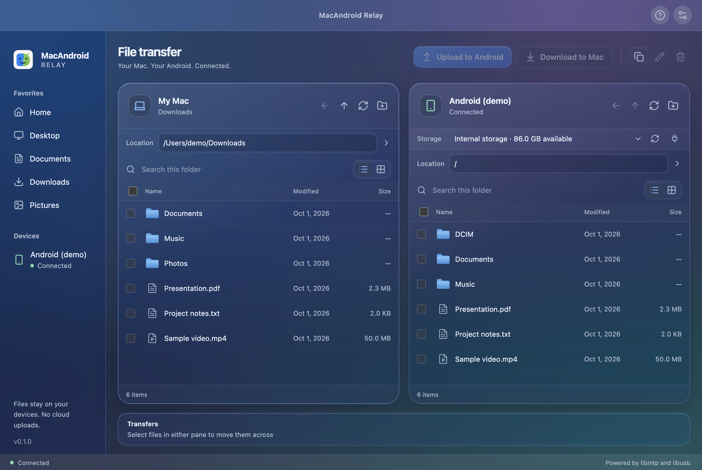

<p align="center">
  
</p>

# MacAndroid Relay

**English** | [简体中文](README.zh-CN.md)

**Transfer files between your Mac and Android device over USB.**

MacAndroid Relay is an open-source macOS file transfer app with a two-pane interface, English and Simplified Chinese support, and drag-and-drop transfers. It uses [libmtp](https://github.com/libmtp/libmtp) and [libusb](https://github.com/libusb/libusb) for MTP communication. File transfers do not require a cloud service or an account.



_Interface preview with example files and a simulated device._

## Features

- **Browse side by side:** Mac and Android file panes with list and grid views, search, hidden files, and keyboard selection.
- **Transfer both ways:** upload and download files or folders, including Unicode filenames, empty files, and nested directories.
- **Drag and drop:** transfer between panes or upload files directly from Finder.
- **Jump to a path:** enter a folder path and press Return; a file path opens its parent and selects the file.
- **Manage files:** create folders, rename, delete, and copy paths, with overwrite confirmation. Mac deletions go to the Trash.
- **Choose your appearance:** light, dark, or system theme, with English and Simplified Chinese interfaces and native menus.

## Platform support

| Platform              | Status                                                   |
| --------------------- | -------------------------------------------------------- |
| macOS · Apple Silicon | Verified with a Redmi K50 Pro                            |
| macOS · Intel         | Native libraries included; hardware verification pending |
| Windows / Linux       | Not currently supported by this app                      |

The project is in early development. Device compatibility reports are welcome; verification with one phone does not imply support for every Android device.

## Installation

The project currently provides a **build-from-source workflow**. Prebuilt downloads are not documented yet.

Requirements:

- macOS.
- Node.js 24 recommended; Node.js 22.12 or later required.
- npm and network access for the first dependency installation.

Clone or download this repository, open its directory, and run:

```sh
# If you use nvm, select the version in .nvmrc first:
nvm use

npm ci
npm run package:mac
```

The application bundle is generated for your Mac's architecture:

- Apple Silicon: `release/mac-arm64/MacAndroid Relay.app`
- Intel: `release/mac/MacAndroid Relay.app`

Current local builds are ad-hoc signed and are not notarized. Maintainers distributing public binaries must configure Apple Developer signing and notarization.

## Usage

1. Connect your Android device with a USB **data** cable.
2. Unlock the phone and select **File Transfer / MTP** in its USB settings.
3. Close other applications using the device, then click **Connect**.
4. Browse your Mac on the left and Android on the right. Select files and use the transfer buttons, or drag files to the other pane.

Use the location field to navigate directly to a path. The Mac pane accepts absolute paths, relative paths, and `~`. Language and appearance can be changed in **Settings**.

### Connection troubleshooting

- Check that the cable supports data, the phone is unlocked, and MTP mode is enabled.
- Quit other Android transfer applications; only one application can own the device's MTP interface at a time.
- Try **Reconnect**. If the device is still unavailable, unplug it, reconnect, and select File Transfer again.
- Include the app's diagnostics when reporting a connection problem. Review them for personal information before posting.

### Current limitations

- There is no transfer cancellation button. Quit handling can wait for an active transfer to finish.
- Files deleted from Android do not go to the Mac Trash.
- Intel compatibility has not yet been verified on physical hardware.
- The native-library build command can build both architectures, but does not produce a universal Electron application.

## Mac App Store

A MAS adaptation is in progress; signed sandbox and USB verification are still pending. See the [MAS preparation guide](docs/MAC_APP_STORE.md) for certificates, entitlements, and validation steps.

## Development

The UI uses React and TypeScript with Vite. Electron provides the desktop integration, and a separate utility process runs the libmtp backend. The renderer uses an allowlisted preload API with Node integration disabled, sandboxing, and context isolation.

```sh
npm ci
npm run dev
```

Renderer changes use React Fast Refresh. Electron main-process, preload, and service changes rebuild and restart the development app.

Before submitting a change:

```sh
npm run typecheck
npm test
npm run format:check
npm run build
```

The C/FFI tests require Xcode Command Line Tools. Normal development uses the bundled native libraries; rebuilding them also requires `pkg-config`.

See [CONTRIBUTING.md](CONTRIBUTING.md) for the project layout, verification commands, and contribution workflow. The [native build guide](native/README.md) documents pinned sources, checksums, and the macOS compatibility patch.

## Contributing

Bug reports, device compatibility results, translations, and pull requests are welcome.

For a bug report, open an issue in this repository with your macOS version, Mac architecture, Android model and version, app version, steps to reproduce, and relevant diagnostics. Please avoid including personal files, device serial numbers, or other private information.

## License and acknowledgements

Application code is provided under the [MIT License](LICENSE). Third-party components retain their own licenses and copyright notices; see [THIRD_PARTY_NOTICES.md](THIRD_PARTY_NOTICES.md).

Thanks to the [libmtp](https://github.com/libmtp/libmtp) and [libusb](https://github.com/libusb/libusb) maintainers. Their libraries provide the underlying transport; this project does not claim to implement the MTP protocol from scratch.
