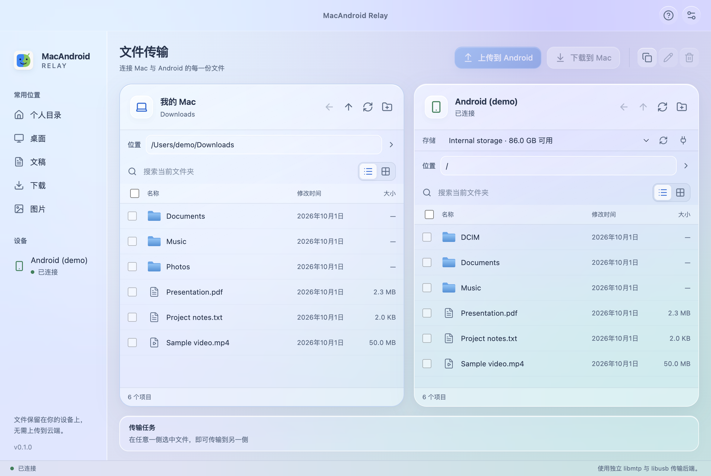

<p align="center">
  
</p>

# MacAndroid Relay

[English](README.md) | **简体中文**

**通过 USB 在 Mac 与 Android 设备之间传输文件。**

MacAndroid Relay 是一款开源 macOS 文件传输应用，提供双栏浏览、英文与简体中文界面及拖放传输。底层使用 [libmtp](https://github.com/libmtp/libmtp) 和 [libusb](https://github.com/libusb/libusb) 进行 MTP 通信。文件传输不需要云服务或账号。



_界面预览使用示例文件与模拟设备。_

## 功能

- **双栏浏览：**同时查看 Mac 和 Android 文件，支持列表与图标视图、搜索、隐藏文件和键盘选择。
- **双向传输：**上传、下载文件或文件夹，支持中文名称、空文件和嵌套目录。
- **拖放操作：**跨栏传输，或直接从 Finder 拖入文件上传。
- **路径跳转：**输入文件夹路径并回车跳转；输入文件路径会打开父目录并选中文件。
- **文件管理：**新建文件夹、重命名、删除、复制路径及覆盖确认。本地删除进入废纸篓。
- **语言与外观：**浅色、深色和系统主题，英文与简体中文界面及原生菜单。

## 平台支持

| 平台                  | 状态                      |
| --------------------- | ------------------------- |
| macOS · Apple Silicon | 已使用 Redmi K50 Pro 验证 |
| macOS · Intel         | 随附原生库，尚待真机验证  |
| Windows / Linux       | 当前应用不支持            |

项目处于早期开发阶段，欢迎提交设备兼容性反馈。单台手机验证通过，不代表已支持所有 Android 设备。

## 安装

当前提供**从源码构建**的使用方式，尚未提供预编译下载说明。

环境要求：

- macOS。
- 推荐 Node.js 24，最低要求为 Node.js 22.12。
- npm；首次安装依赖时需要网络连接。

克隆或下载本仓库，进入工程目录后执行：

```sh
# 如果使用 nvm，先选择 .nvmrc 中的版本：
nvm use

npm ci
npm run package:mac
```

应用包按照当前 Mac 架构生成：

- Apple Silicon：`release/mac-arm64/MacAndroid Relay.app`
- Intel：`release/mac/MacAndroid Relay.app`

当前本地构建使用 ad-hoc 签名，尚未公证。维护者正式分发二进制时，需要配置 Apple 开发者签名和公证。

## 使用方法

1. 使用 USB **数据线**连接 Android 设备。
2. 解锁手机，在 USB 设置中选择**文件传输 / MTP**。
3. 退出其他占用设备的应用，再点击**连接**。
4. 左侧浏览 Mac，右侧浏览 Android；选中文件后点击传输按钮，或将文件拖到另一栏。

使用路径栏直接跳转。Mac 侧支持绝对路径、相对路径和 `~`。语言和外观可在**设置**中切换。

### 连接故障排查

- 确认数据线支持数据传输，手机已解锁并开启 MTP。
- 退出其他 Android 传输应用；同一时间只能有一个应用独占设备的 MTP 接口。
- 尝试**重新连接**。仍无法连接时，拔插数据线，并重新选择文件传输。
- 报告连接问题时附上应用诊断信息，发布前检查并移除个人信息。

### 当前限制

- 没有传输取消按钮；退出时可等待正在进行的传输完成。
- Android 上删除的文件不会进入 Mac 废纸篓。
- Intel 兼容性尚未通过真机验证。
- 原生库构建命令可以编译两种架构，但不会生成通用架构的 Electron 应用。

## Mac App Store

MAS 适配正在进行，真正签名的沙箱和 USB 验证仍待完成。证书、权限配置及验收步骤见[商店适配指南](docs/MAC_APP_STORE.zh-CN.md)。

## 开发

界面使用 React、TypeScript 和 Vite；Electron 提供桌面集成，独立 utility process 运行 libmtp 后端。渲染层通过白名单 preload API 访问桌面能力，关闭 Node 集成并启用沙箱和 context isolation。

```sh
npm ci
npm run dev
```

渲染层修改使用 React Fast Refresh。修改 Electron 主进程、preload 或服务代码时，开发应用会重新编译并重启。

提交修改前执行：

```sh
npm run typecheck
npm test
npm run format:check
npm run build
```

C/FFI 测试需要 Xcode Command Line Tools。普通开发使用随附原生库；重新构建原生库还需要 `pkg-config`。

工程结构、验证命令和贡献流程见[贡献指南](CONTRIBUTING.zh-CN.md)。固定源码、校验值及 macOS 兼容补丁见[原生构建说明](native/README.zh-CN.md)。

## 参与贡献

欢迎提交问题报告、设备兼容性结果、翻译和 Pull Request。

报告问题时，请在本仓库创建 Issue，说明 macOS 版本、Mac 架构、Android 型号与版本、应用版本、复现步骤及相关诊断。请勿公开个人文件、设备序列号或其他隐私信息。

## 许可与致谢

应用代码采用 [MIT 许可证](LICENSE)。第三方组件保留各自的许可证和版权声明，详见[第三方声明](THIRD_PARTY_NOTICES.zh-CN.md)。

感谢 [libmtp](https://github.com/libmtp/libmtp) 和 [libusb](https://github.com/libusb/libusb) 的维护者。底层传输能力由这些库提供，本项目不宣称从零实现了 MTP 协议。
